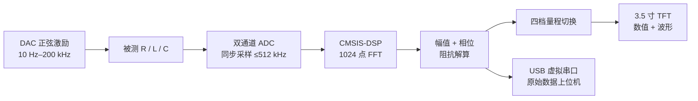

# RLC_dac_study_flash · RLC 阻抗测量仪

**DAC 打正弦、双 ADC 采幅相、FFT 解阻抗：一台能自己认 R/L/C 的便携仪器**

[快速开始](#3-快速开始与关键实现) · [常见问题](#4-常见问题) · [全部仓库索引](https://github.com/xhtfps/xhtfps)

## 一台仪器该有的闭环

电赛仪器题的完整链路是：**激励 → 采集 → 解算 → 判型 → 显示 → 校准**。这个仓把六步都跑通了，而且把「为什么读数会跳」「相位为什么随频率漂」这类现场问题写进了 FAQ，不是交个能出数的 demo。

## 亮点

- **四档量程自动切换**：47 Ω / 820 Ω / 15 k Ω / 270 k Ω，切换边界留 10% 回差，避免在临界点来回抖。
- **三项现场校准**：短路零点、标准电阻相位偏移、逐档标准件系数，系数存 Flash 掉电不丢。
- **判型有明确门限**：|相位| < 10° 判纯阻、> 30° 判感、< -30° 判容，复合网络另做拓扑判定。
- **结项可交付**：已打 `v1.0` tag 并发 Release，固件镜像走 Release 附件，不进仓库。

## 结构

## 1. 目录一览

| 目录/文件 | 内容 |
| --- | --- |
| `_01_App/` | 应用层：测量流程、菜单逻辑 |
| `_02_Core/` | 时钟、中断、CMSIS 启动 |
| `_03_Drive/` | DAC / ADC / TIM / GPIO 驱动 |
| `_04_FWLib/` | STM32 HAL 固件库 |
| `_05_Os/` | FreeRTOS 任务划分 |
| `_06_System/` | 延时、调试打印等系统工具 |
| `_07_TFT_LCD/` | 3.5 寸 TFT-LCD 驱动与 UI |
| `_08_USB/` | USB 虚拟串口（向上位机传原始数据） |
| `DSP_LIB/` | CMSIS-DSP 算法库（FFT、滤波） |
| `main.c` / `Read.txt` / `CLAUDE.md` | 入口、补充说明、开发记录 |

## 2. 环境

| 项 | 要求 |
| --- | --- |
| 主控 | STM32F407ZGT6（168 MHz，HSE 8 MHz） |
| IDE | Keil MDK-ARM 5.37，器件包 `Keil.STM32F4xx_DFP` |
| 固件库 | STM32 HAL + CMSIS-DSP 1.9.0 |
| 调试 | J-Link V11（SWD） |
| RTOS | FreeRTOS 10.3.1 |
| 外设 | 3.5 寸 TFT-LCD（320×480）、USB 虚拟串口 |

## 3. 快速开始与关键实现

1. 打开工程 `.uvprojx`，全编译确认 0 error，J-Link 下载。
2. 首次运行先做三项校准：短路探头做 ADC 零点、接标准电阻做相位偏移、逐档位输入标准 R/C/L 生成校准系数（存入 Flash，掉电不丢）。
3. 校完接被测元件，菜单选自动识别或指定类型，屏幕直出阻抗模值与相位。
4. 关键参数：激励 10 Hz～200 kHz、幅值 0.1～3.0 Vpp；ADC 同步采样最高 512 kHz；FFT 1024 点实序列。
5. 识别门限：|相位|<10° 判为纯阻 R；相位>30° 判为感 L；相位<-30° 判为容 C；复合网络（RC/RL/LC 串并联）另做拓扑判定。
6. 量程：47Ω / 820Ω / 15kΩ / 270kΩ 四档，切换边界留 10% 回差防抖动。

## 4. 常见问题

- **读数周期性跳变**：量程在边界来回切，先看回差逻辑，或把激励幅值调入下一档的舒适区。
- **相位偏差大且随频率漂**：未做全频段相位校准；用纯电阻在扫频下逐点标定。
- **低频段读数不稳**：1024 点窗口内周期数太少，降低起始频率或加窗（Hanning）。
- **USB 无串口**：先装 ST 官方 VCP 驱动，再确认 `_08_USB` 已初始化。
- **`keilkilll.bat` 用途**：清理残留 Keil 进程，下载异常时先跑一遍。

## 5. 维护说明

- 已清理 `JLinkLog.txt`、`*.uvguix.*`、`*.uvoptx` 等生成物；详见 [`EXCLUDED_FILES.md`](EXCLUDED_FILES.md) 与 `.gitignore`。
- 结项版本已打 tag 并发 Release（v1.0）；固件镜像走 Release 附件，不入库。
- 后续方向：量程扩到 1mΩ～100MΩ、加温度补偿、上 STM32H7、配电池供电。
- 第三方组件（ST HAL、CMSIS-DSP、FreeRTOS）按各自许可证使用。
## 路线图

- [x] 激励-采集-解算-判型-显示全链路打通，结项发布 v1.0
- [x] 校准系数 Flash 持久化与四档量程回差
- [ ] 量程扩到 1 mΩ–100 MΩ
- [ ] 加温度补偿与电池供电，做成手持版

## 参与与反馈

- 遇到问题请走 [Issue 模板](.github/ISSUE_TEMPLATE)，附上激励频率、量程档位与屏幕读数。
- 提 PR 前先读 [CONTRIBUTING.md](CONTRIBUTING.md)；安全问题按 [SECURITY.md](SECURITY.md) 私下反馈。
- 如果这个仓库帮你省过时间，点个 ⭐ 是最省事的支持。

## 许可证

本仓自写代码以 [MIT](LICENSE) 分发；ST HAL、CMSIS-DSP、FreeRTOS 按各自许可证使用。
